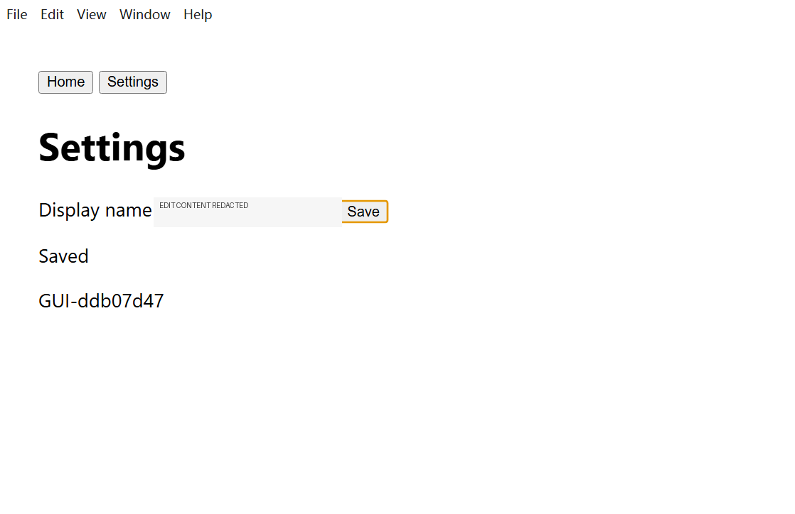

# Windows GUI 验收

平台：Windows 11，Python 3.12（uv）、Node 24、Electron 38。保留既有 manual-fixtures 路径与测试契约。

## 三层证据

1. Python 原生 GUI/M3/M4/M5：实际窗口、UIA、输入、截图与 Observer 测试；要求交互桌面，不能用 Mock 结果替代。
2. Electron desktop-smoke：真实桌面程序/Renderer/IPC/后端/HTTP 传输，模型由本地 HTTP Mock 控制。覆盖统一聊天、真实文件及 unittest/Diff、设置、审批、取消、恢复、Git/Context/MCP 等。
3. 在线模型 + 真实 GUI：使用已通过能力检查的 qwen3.7-flash，经统一聊天入口调用实际 Windows UIA；以新随机显示名、Saved 状态、磁盘持久化值和本机截图交叉验证，不允许用直接写入 saved.json 代替界面动作。

本轮 desktop-smoke 已通过 53 项、无跳过，扩展检查运行中追加消息、一次应用、请求事件关联和完整事件 JSON 导出。真实在线模型已完成 Electron 源码修复、typecheck/test/build，独立启动窗口编辑保存；另一次真实在线任务使用 UIA 完成定位、点击、输入、保存、读取状态、截图和停止进程。输入框按隐私策略在截图中遮盖，底部显示的是随机测试值。


截图 SHA256：`a9bdc00cd6a89a74bb5afec8e1c36b593fe4de5cc997e2e527c27d1149d2ba5d`。这是窗口截图，没有上传给模型，不代表真实视觉推理验收。对应元数据见 [脱敏在线证据](evidence/live-cases.json)。

未附独立 GUI 合约的交互在产品中保持待独立验收；本报告的 GUI PASS 来自外部实际结果检查。高级 Task 的已有冻结 GUI 合约与 Observer 回归保留，不能把本地 HTTP Mock Observer 说成真实视觉模型。

命令：

```powershell
$env:LCA_REQUIRE_INTERACTIVE_DESKTOP='1'
uv run --locked python -m unittest discover -s tests -p test_m5_electron_e2e.py -v
npm --prefix desktop run build
node scripts/validation/desktop-smoke.cjs
```

只操作测试程序及隔离目录，不删除用户历史、关闭无关应用或自动恢复用户任务。

本机曾在并行 Vitest/多个桌面运行叠加时遇到 VirtualAlloc/V8 内存失败，原始失败报告保留。后续采用串行桌面验收、单 worker 前端测试；一次 React 进程回归在资源恢复后单独复测通过。CI 的首次冷启动窗口枚举超时已按真实 UIA 工具允许的 60 秒预算处理，保留所有窗口、输入、截图、停止和恢复断言，没有跳过真实 GUI 测试。

## 2026-11-05 最后真实补测：PASS

旧 BLOCKED 不改写。Windows 在 `2026-11-04T21:32:22.763340Z` 记录 Resource-Exhaustion-Detector / Event 2004，确认当时虚拟内存耗尽。旧驱动没有捕获那个进程的退出码与异常堆栈，不能事后编造；旧 Renderer 日志显示页面已经加载。机器于 2026-11-05 08:15 外部重新启动后，可用内存约 7 GB；本 Agent 没有执行重启或终止用户程序。

资源恢复后的第一次补测进入实际在线请求：11 调用、80481 Token，但模型在获得就绪标记前要求枚举窗口，验收驱动正确拒绝。另发现测试目录残留旧 PID 文件和驱动关闭后重新查询 `app.process()` 的生命周期问题。已归档残留文件，要求 PID 同时匹配本次 stdout 的 `M5_ELECTRON_READY` 与新生成的 process.json；保留进程引用以记录退出码。没有放宽产品审批、没有改源码或 saved.json 代替界面动作。

第二次有依据的补测只执行纯 GUI，使用 **qwen3.7-flash**，报告 `validation-reports/v06-gui-ready-final-20261105/report.json`：

- **PASS，68 秒，14 次真实 API 请求，全部 HTTP 200，193899 Token，准确 Usage。**
- 真实 Agent 从统一聊天入口启动已有 Electron 工程，等待本次 PID，枚举并检查窗口，点击 Settings，输入新随机值 `GUI-ddb07d47`，审批后点击 Save，读取 Saved 状态、截图并停止程序。
- 本机持久化值、真实截图和模型工具结果一致；冻结源码不变，`changed_paths=[]`。
- 产品为 `completed / completed_unverified / manual`，正确区分动作完成与产品内独立 GUI 合约。外部验收实际检查截图/磁盘/动作证据后 PASS，不把它改成代码测试通过。
- Electron 仅在验收清理时正常退出，**exit_code=0、signal=null**，无运行中崩溃；子进程和请求阶段证据已保留，未发现本轮残留测试进程。
- 保存首次缺少风险确认被工具拒绝，随后原审批允许，证明未关闭安全机制。

新增驱动回归 3 项全部通过：历史 PID 不能授权、关闭后仍保留退出码、有界清理只针对自有进程；双平台 CI 也执行这些断言。

新截图（输入框沿用产品隐私遮盖，Saved 下方为随机测试值）：



SHA256：`0ce2174d8edfa2c09582ec96ca264072116228008f7884782df694fe540ee5cd`。完整脱敏 HTTP/工具/审批/进程证据见 [gui-final-20261105.json](evidence/gui-final-20261105.json)。截图未上传模型，不是视觉推理验收。

该必需补测已完成；合并须继续以 PR #29 最终 HEAD 的全部 CI 绿色为门禁，不使用历史归档的合并例外。
