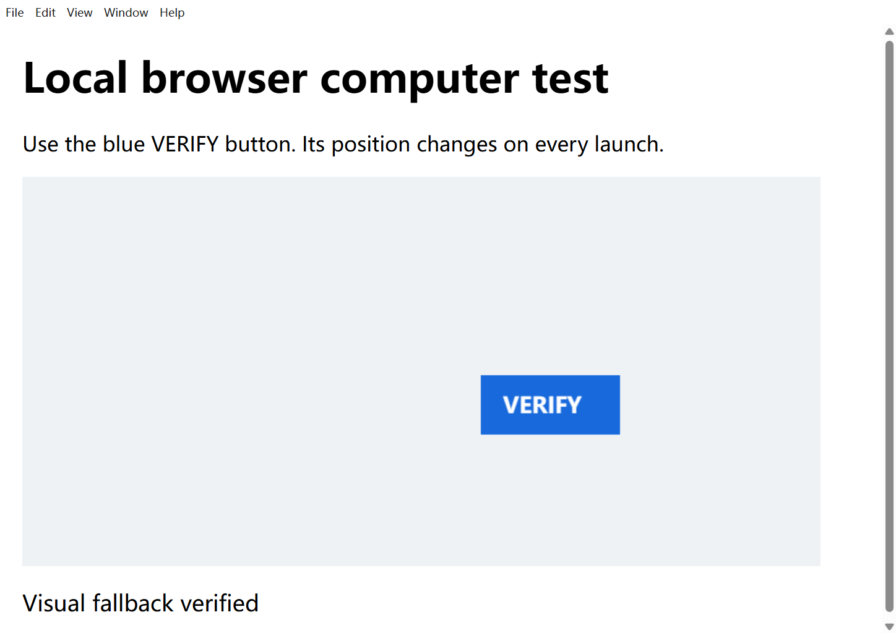

# v0.7 Windows Computer Agent 专项验收

日期：2026-11-05，Windows 11，16 GB 内存，uv Python 3.12、Node.js/Electron。基线：`d385d95feac4f9a889ecd699edebcdaa89b75dc2`；分支：`feature/v0.7-computer-agent`；实现提交：`6f78fc76e244e5dad6e8b7d3fc21fd605ee92ae9`。最终文档提交以 PR HEAD 为准。

**功能验收结论：PASS，合并仍以 PR #30 最新 Windows/Ubuntu CI 为门禁。** 本次用户追加可用模型后，`qwen3.8-max-0902` 在全新、未受外部诊断文件污染的夹具中完成 UIA→真实图片→坐标操作→等待失败后自行重新定位→真实验证→截图→停止进程→正常结束。16 请求、172,692 Token（服务端 Usage），夹具文件及 Git HEAD 均未变。此前失败和 403 全部保留，不能拿新 PASS 改写历史结果。没有 Release/Tag，没有进入 v0.8/v0.9。

验收范围：原生应用使用真实生产工具的确定性集成；新增 Canvas 视觉闭环由真实模型自主决策。不是声称每款模型都能完成所有原生应用任务。产品该 GUI 运行状态为 `completed / completed_unverified / manual`，准确表示未配置独立 GUI 合约、没有代码测试结论；本次外部验收依据真实 UIA 状态、应用结果文件、未改夹具及窗口截图判为 PASS，未把数据库改成 verified。

## 十项能力

PASS 仅指所列范围。原生测试使用真实 Windows 窗口、生产 ToolRegistry/DesktopRuntime，但决策由脚本完成，**不是模型自主完成全部十项**。M3/M5 模型决策为 Mock，GUI 本身真实；真实模型另表记录。

| 能力 | 状态 | 本轮证据与边界 |
| --- | --- | --- |
| 1. 窗口发现、定位、激活 | PASS（工具集成） | 记事本、计算器、Explorer、Edge 实际发现/激活；M3 窗口代际、会话与遮挡保护。未将启动包装器 PID 冒充窗口 PID。 |
| 2. UIA 控件树与定位 | PASS（工具集成） | RichEdit Document、计算器按钮和结果、Edge 本地按钮。真实 Edge 暴露旧深度 8 不足，扩至 24，仍限制总节点 200、超限拒绝不完整树。 |
| 3. UIA 失败后的视觉回退 | PASS（真实模型） | `v07-user-max-clean-visual`：真实控件未找到→授权脱敏图片 HTTP 200→坐标点击→状态验证→正常结束，夹具/HEAD 不变。此前 FAIL/403 保留在后表。 |
| 4. 鼠标、键盘、输入、滚动 | PASS（工具集成） | M3 WinForms 输入/滚动/快捷键，原生中文输入，150% DPI 实际坐标点击；像素算法校准不计作模型视觉 PASS。 |
| 5. 操作后真实验证 | PASS | UTF-8 文件、计算器结果、Explorer 标题、Edge UIA 状态及模型视觉目标状态均核实；视觉等待初次失败后实际重查、成功复测，不把发出点击当成功。 |
| 6. 记事本输入、保存、读取 | PASS（工具集成） | `v07-notepad-verified`，27 字符中文/多行、Ctrl+S、外部文件精确比较。 |
| 7. 计算器操作与结果 | PASS（工具集成） | `v07-calculator-verified`，UIA 按键，CalculatorResults 实际 `2+3=5`。 |
| 8. 文件管理器操作 | PASS（导航）；清理异常已补救 | `v07-explorer-verified`，地址栏进入测试目录并返回。初次关闭 Invoke 报 `DESKTOP_API_FAILED`；后续只对该测试窗口 Alt+F4，再列窗确认消失。 |
| 9. Electron 测试应用 | PASS（工具及真实模型） | 原 M5 保留；新增 Canvas fixture 通过生产坐标工具集成及 max-0902 真实模型闭环，真实状态、冻结文件及窗口截图独立核实。 |
| 10. 异常恢复、取消与释放 | PASS（已测路径） | M3 取消/超时/worker 清理，Edge 结束 worker/受管理进程=0；系统测试窗口已不可见；低内存不创建 worker。真实模型等待失败→重查 UIA→成功等待→停止进程；Electron 正常 exit=0，非强制关闭。 |

浏览器额外检查：PASS（真实工具集成）。一个隔离 Edge profile 打开本地轻量页面，UIA 点击并等待 `Local page verified`；窗口关闭、worker=0、受管理进程=0。无网站网络依赖。

## 修复与复用

复用原桌面 worker、Tool Registry、权限/审批、Job 进程树、统一聊天、Provider、Observer、持久计划及独立验证，没有平行 Agent。

- `agent/desktop/resources.py`：只读物理内存和系统提交余量；不足 `BLOCKED_RESOURCE`，不创建 worker。生产默认各 512 MiB，验收预检各 1 GiB。
- `visual_target.py`、`runtime.py`：截图回执绑定 owner/窗口/时效/DPI/尺寸/位置，区分物理、缩略图和 0..1000 坐标，拒绝过期/跨窗口/未共享截图。图像去重仍保留回执，网格版本与普通图分别去重；网格只加在脱敏缩略图副本。
- `worker.py`：现代记事本 RichEdit Document 使用只读检查、精确焦点、有限读取、逐段及最终读回；处理 CRLF/隐含末尾段落 CR。网页 Document/任意 Pane 仍拒绝。UIA 深度扩展但总节点上限不变；布尔坐标拒绝。
- `unified_runtime.py`、`server/main.py`：明确纯 GUI 请求同时限制模型工具列表及真实分派，防止读源码/脚本/改文件伪造 GUI 成功；普通开发工具不受无关限制。Observer 只做视觉描述，无执行工具权限。
- `computer_native.py`：原生应用归属、真实读回、启动器生命周期、关闭兜底和清理复查；UWP 可复用进程，不按宿主 PID 强杀。
- 补充视觉等待证据：记录 state、秒数、是否提供 selector 及允许字段；非夹具文字脱敏，避免再次因参数未留存而无法定位。新增保护回归，不冒充过去的调用参数。
- `unified_live.py/cjs`：真实 Electron/API 驱动、图片传输/坐标证据、进程退出和内存，有限重试；隔离配置不覆盖用户设置。
- 新增 `tests/test_v07_computer.py` 16 项回归；`manual-fixtures/v07-computer-agent` 随机 Canvas 按钮、独立点击状态和指针证据。已有 M3/M4/M5 路径、契约不变。
- `ActionMenu.tsx`：旧 HEAD 的 PR CI（run `41971358619`，Windows Smoke）暴露后台聊天滚动误关闭 Diagnostics 菜单。原捕获监听器对任意 scroll 都关闭；改为仅文档/窗口或锚点祖先滚动关闭，保留真实窗口 resize、外部点击、键盘行为。真实 Electron 新增“聊天滚动保留、文档滚动关闭、Diagnostics 可点”回归；类型/62 前端/build 重测通过，Smoke 54/54。没有增加超时、force click 或降低断言。
- 版本元数据 0.7.0 开发版；协议/数据库兼容，不等于发布。

## 命令及自动化结果

仓库根目录，串行执行：

```powershell
uv sync --locked
uv run --locked python -m unittest discover -s tests -p test_v07_computer.py -v
uv run --locked python -m unittest discover -s tests -p test_m3_desktop.py -v
$env:LCA_REQUIRE_INTERACTIVE_DESKTOP='1'
$env:VITEST_MAX_THREADS='1'
$env:VITEST_MIN_THREADS='1'
$env:NODE_OPTIONS='--max-old-space-size=256'
$env:GOMAXPROCS='2'
uv run --locked python scripts/validation/check.py
node scripts/validation/desktop-smoke.cjs
node --test scripts/validation/live_gui_guard.test.cjs
git diff --check
```

| 检查 | 结果 |
| --- | --- |
| v0.7 新增单元/契约 | PASS：16/16，`validation-reports/v07-unit-contract-final.log` |
| M3 真实 Windows GUI 回归 | PASS：11 项中 10 通过、1 条件跳过，`v07-m3-regression.log` |
| 版本元数据一致性 | PASS：4/4，`v07-release-metadata.log` |
| 全量 Python / 类型 / 前端 / build | PASS：Python 567 项，565 通过、2 平台跳过、0 失败；前端 62/62；类型检查/build exit=0。`20261105-124815-729605.json/.log` |
| Electron Smoke / 驱动保护 | PASS：修复菜单后 54/54，0 跳过（初次 53/53 记录保留）；保护测试 4/4；`v07-desktop-smoke.log`、`v07-live-gui-guard.log` |
| Windows / Ubuntu CI | 实现提交 `6f78fc7` 双平台 PASS，run `41970333245`；最终文档/驱动提交仍须检查 PR #30 最新 Checks |

原生 GUI 可复现命令（输出目录使用新路径，各项依次执行）：

```powershell
uv run --locked python scripts/validation/computer_native.py --scenario notepad --output validation-reports/v07-company-notepad
uv run --locked python scripts/validation/computer_native.py --scenario calculator --output validation-reports/v07-company-calculator
uv run --locked python scripts/validation/computer_native.py --scenario explorer --output validation-reports/v07-company-explorer
uv run --locked python scripts/validation/computer_native.py --scenario browser --output validation-reports/v07-company-browser
```

## 真实模型结果

实际 GUI 用例从 LCA Electron 聊天提交，经后端、Provider 和生产工具，不是 API 文本回复冒充。禁止的两种模型及变体未调用；Ollama 功能保留，真实连接 SKIPPED（用户要求）。未修改日常模型配置。

基础探针：`qwen3-vl-plus`、`qwen3.5-omni-flash`、`qwen3-omni-flash`，每个文本/真实图片/工具共 3 请求，合计 9 请求、服务端 Usage 1,859 Token，全部 PASS。只能证明当时基础能力，不证明完整任务通过，也不推定 Provider 最大上下文。

| 本地证据目录（validation-reports 下） | 模型 | 请求数 | 账本 Token | 结果 |
| --- | --- | ---: | ---: | --- |
| v07-visual-real | qwen3-vl-plus | 16 | 188640（Usage） | FAIL：真实 UIA/图片/点击后工具未收敛，早期审批过严已调整 |
| v07-visual-final | qwen3.5-omni-flash | 7 | 70260（含估算） | FAIL：进程归属/工具失败，最终不完整流 |
| v07-visual-verified | qwen3-vl-plus | 14 | 137550（Usage） | FAIL：图片/点击后验证未通过 |
| v07-visual-grid | qwen3-omni-flash | 13 | 113311（Usage） | FAIL：**应用 verified=true**，后续 UIA 等待超时，运行状态 failed |
| v07-visual-acknowledged | qwen3-vl-plus | 1 | 15495（估算预留） | BLOCKED：首次 HTTP 403，无 GUI 操作 |
| v07-visual-receipt | qwen3.5-omni-flash | 10 | 78993（含估算） | FAIL：错误进程句柄/路径后不完整流 |
| v07-visual-paired | qwen3.7-flash，计划 Observer qwen3-omni-flash | 1 | 15489（估算预留） | BLOCKED：执行器 HTTP 403，不能称 Observer 已验收 |
| v07-visual-paired-glm | glm-5.2，计划 Observer qwen3-omni-flash | 1 | 15493（估算预留） | BLOCKED：执行器 HTTP 403 |
| v07-visual-last-receipt | qwen3-omni-flash | 1 | 15495（估算预留） | BLOCKED：HTTP 403，之后停止在线尝试 |

含估算/保守预留不能当作实际计费 Token；费用 UNKNOWN。每次尝试均有请求/Token/单请求超时/总时长限制，不无限重试。

### 用户追加模型后的复验

实际模型列表确认 `qwen3.8-max-0902`、`qwen3.8-27b` 存在；两者文本/真实图片/工具探针各 3 次均 PASS，共 6 请求、1,881 Token。`kimi-k3.1-pro` 未在此次实际列表中找到，未强行调用；未将图片生成、视频或翻译模型作为桌面 Agent 替代品。

- `v07-user-max-visual`：23 请求、313,901 Token。点击与重查 UIA 后等待成功，但监督诊断错误地把输出放入被测工作区，触发了无关代码验证，最终该场景 FAIL。**受污染，不计通过，不归因产品缺陷。** 进程最终正常退出，无需外部强杀。没有删除失败文件或改写任务状态挽救结果。
- `v07-user-max-clean-visual`：全新夹具，无外部文件写入；**PASS**，16 请求、172,692 Token，服务端 Usage、非估算。图片实际附加/HTTP 200，UIA 未找到后的真实坐标点击，应用 `verified:true`，初次 wait 超时后模型自己 inspect、修正 selector，再次 wait 成功；最终截图、stop_process、正常结束。冻结文件和 HEAD 未变；诊断 22 行，JSON/Markdown 均存在，Electron exit=0、forced=false。



根因边界：旧用例没有完整保留 wait 参数，不能倒推所有旧失败原因。新复验记录到初次等待依赖 automation_id/control_type，当前结果 Text 的真实 automation_id 为空；模型重新 inspect 后改用真实 name/runtime_id，等待成功。说明不能将网页 DOM id 假定为 UIA automation_id。独立 `v07-coordinate-wait-verified` 也证明实际结果选择器可以成功等待，但它不是模型自主验收。新增驱动会留存脱敏 wait 参数；没有修改产品数据库、放宽成功条件或替模型完成操作。此前 403 属于旧候选的当时实际失败，新的允许候选已用真实请求证明可继续工作。


## 资源、清理及证据

本轮真实 GUI 前可用内存约 6.2–7.0 GiB，原生快照约 7.2–7.5 GB、提交余量约 28 GB，非分页池约 1.1–1.9 GB。**本轮没有真实 BLOCKED_RESOURCE**；低内存分支通过 Mock 测试，不能把旧候选的在线 403 归为内存不足。

先单元/集成，再串行 GUI。没有并发多个测试场景，没有更改系统内存/强杀用户应用。单场景 Electron 自带多进程与受控目标不是多场景并发。

Explorer 关闭 Invoke 异常原样保留；独立 `v07-owned-cleanup/report.json` 核实记事本/计算器测试窗口不可见，仅对明确匹配的 Explorer 测试窗口 Alt+F4 并复查。Edge 最终窗口关闭且 worker/受管理进程=0。不能把关闭异常当作未发生。

公开脱敏元数据：[evidence/acceptance.json](evidence/acceptance.json)，仅受控结果、坐标、资源、错误类别、本地原始报告 SHA-256。完整失败报告/受控截图留在本机 `validation-reports/v07-*`。窗口枚举可能含用户应用标题，不上传 Git；不提交 API Key、Authorization、完整 Prompt、用户文件或凭据副本。哈希不能替代成功证据，元数据明确保留 FAIL。

## 限制与合并门禁

1. 十项能力在上表范围通过；模型自主视觉闭环以 `qwen3.8-max-0902` 为本次有效证据，不泛化成所有模型/所有 Windows 应用都已验收。
2. 任意 UIA/视觉目标、受保护窗口、非当前会话、资源不足仍可能被拒绝；Ollama 真实连接按用户要求 SKIPPED。
3. 原生系统应用的启动宿主、界面版本和 UIA 树会变化；优先 inspect，不使用猜测的 DOM id。Explorer 初次关闭失败及补救记录保留。
4. 最新代码提交 Windows/Ubuntu CI 必须通过后才可合并。旧 PR CI 的真实菜单失败已记录并修复，不以旧 push CI 的成功掩盖它。实现提交 run `41970333245` 已双平台 PASS；PR 最终 Checks 是合并前权威状态，不能以历史结果替代。
5. 不创建 Release/Tag，不进入 v0.8/v0.9。PR： https://github.com/yunfei00/local-coding-agent/pull/30 。

真实模型视觉复验命令（已有安全配置，输出目录使用新路径；不会改日常模型配置）：

```powershell
uv run --locked python scripts/validation/unified_live.py --live --discover-only --output validation-reports/v07-company-discovery --max-calls 2 --max-tokens 10000 --request-seconds 30
uv run --locked python scripts/validation/unified_live.py --live --case visual --discovery-report validation-reports/v07-company-discovery/report.json --candidate-model qwen3.8-max-0902 --only-model qwen3.8-max-0902 --vision-candidate-model qwen3.8-max-0902 --output validation-reports/v07-company-visual --max-calls 30 --max-tokens 500000 --validation-task-calls 30 --validation-task-tokens 500000 --output-tokens 4096 --request-seconds 60
```

以上是真实在线调用；额度由用户阿里云后台控制，驱动另设有限请求/时间/Token 保护。实际使用量依模型结果变化，不承诺相同 Token 或所有模型都通过。不得把监督诊断写入被测工作区。
